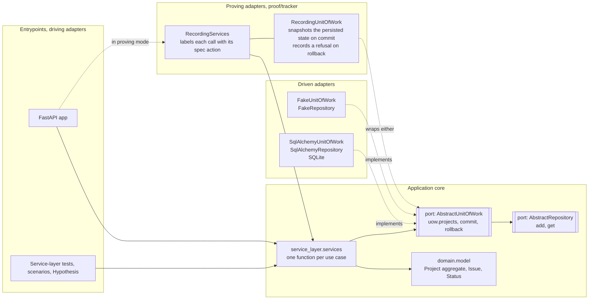
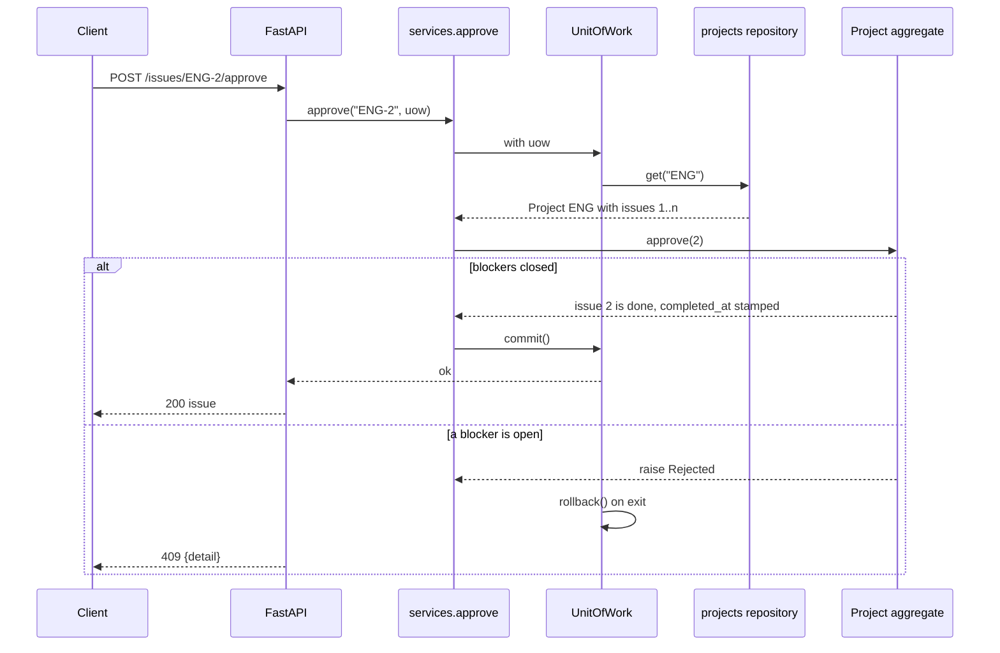
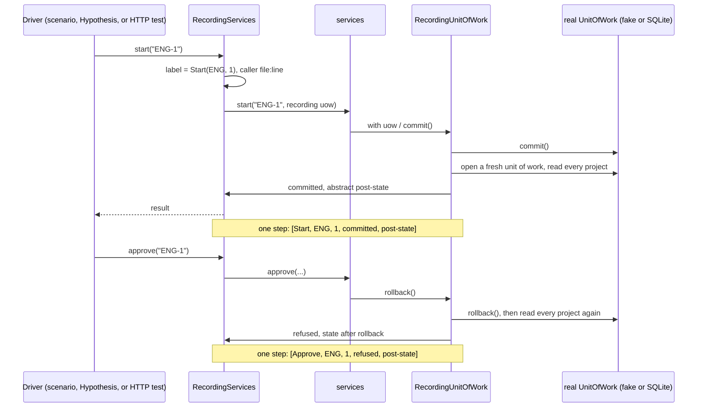
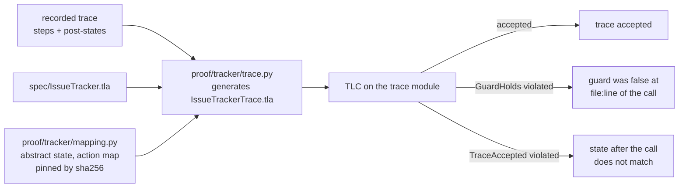
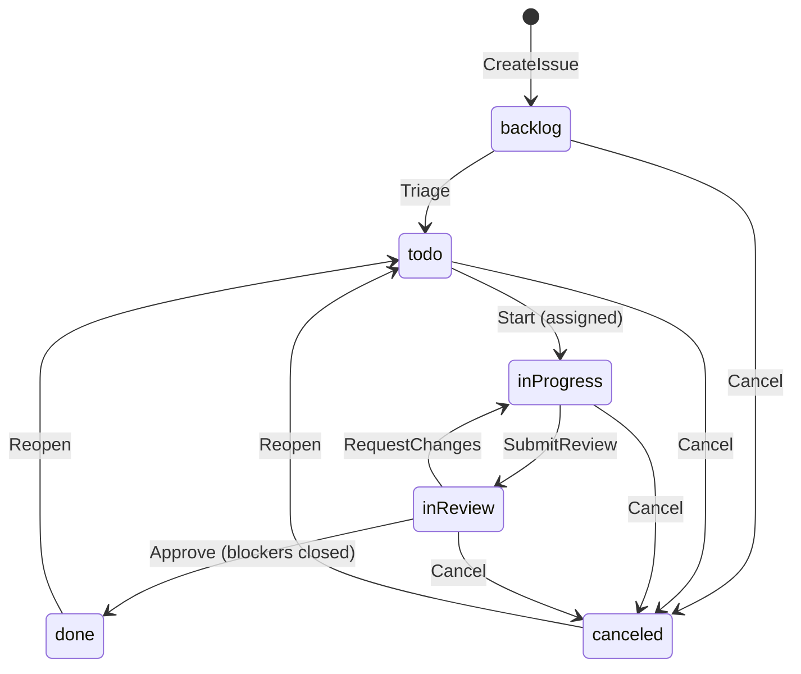

# Issue tracker PoC: a TLA+ spec as the contract of the ports

## The idea in one paragraph

Part 1 of *Architecture Patterns with Python* keeps the domain model free of
infrastructure by depending on small abstractions: Repository, Unit of Work,
Service Layer, Aggregate. What it does not do is state a port's abstract
state and allowed behaviour as a *checked* contract. This PoC adds that. The
TLA+ module `spec/IssueTracker.tla` is the contract: its one variable is what
the application persists through its unit of work, and its actions are the
use cases. A set of proving-purpose adapters records, at the port boundary,
what the application actually wrote on every commit and every rollback. TLC
then replays each recorded trace against the spec. If every step is an
enabled spec action that produces the recorded state, the application core
realises the spec, whatever adapter sat behind the port: an in-memory fake or
SQLAlchemy on SQLite, driven directly or through FastAPI.

The existing `todo_app` stays as the first slice. The tracker is a second,
richer slice next to it, with its own spec, proof package and CI jobs.

## Scope

A small Linear-style tracker, chosen so that every pattern in the reading
plan has a real job to do.

| Concern | What the PoC has | Pattern it exercises |
| --- | --- | --- |
| Aggregate | `Project` (key such as `ENG`) owns its issues, numbered `ENG-1`, `ENG-2`, ... | ch7: one aggregate, one repository, one aggregate per transaction |
| Entity inside the aggregate | `Issue`: title, status, assignee, blockers, comments, timestamps | ch1: entity vs value object |
| Workflow | backlog → todo → inProgress → inReview → done; cancel while open; reopen when closed | ch1: rules as domain methods, refusals as domain exceptions |
| Cross-entity rule | an issue may be blocked by issues of the same project; no cycles; approval waits for blockers | ch7: the invariant decides the boundary |
| Repository | `projects.add(project)`, `projects.get(key)`; no update method | ch2 |
| Unit of Work | context manager, explicit `commit()`, rollback otherwise | ch6 |
| Service layer | one function per use case, primitive arguments, takes a `uow` | ch4, ch5 |
| Inbound adapter | FastAPI app that only does web things | ch4 entrypoints |
| Outbound adapters | fake repository + fake UoW; SQLAlchemy classical mapping + SQLite UoW | ch2, ch6 |
| Concurrency | `version` on `Project`, optimistic check in the repository | ch7, checked by tests, not by the spec |

### Commands (spec actions)

| Service function | Spec action | Guard (spec) | Writes |
| --- | --- | --- | --- |
| `create_project(key, name)` | `CreateProject(key)` | key unused | new project, no issues |
| `create_issue(key, title)` | `CreateIssue(key, title)` | project exists, title non-empty, below bound | issue `next` in backlog |
| `triage(ref)` | `Triage` | backlog | status todo |
| `assign(ref, user)` | `Assign` | open, assignee differs | assignee |
| `unassign(ref)` | `Unassign` | assigned, not in progress or in review | assignee unset |
| `start(ref)` | `Start` | todo and assigned | inProgress, started_at |
| `submit_review(ref)` | `SubmitReview` | inProgress | inReview |
| `request_changes(ref)` | `RequestChanges` | inReview | inProgress |
| `approve(ref)` | `Approve` | inReview, every blocker closed | done, completed_at |
| `cancel(ref)` | `Cancel` | open | canceled, canceled_at |
| `reopen(ref)` | `Reopen` | done or canceled | todo, stamps cleared |
| `add_blocker(ref, blocker)` | `AddBlocker` | same project, open, not already, no cycle | blocked_by ∪ {b} |
| `remove_blocker(ref, blocker)` | `RemoveBlocker` | blocker present | blocked_by \ {b} |
| `comment(ref, body)` | `Comment` | not canceled | comments + 1 |

A refused command is a service call whose guard is false. The domain raises,
the unit of work rolls back, the HTTP adapter answers 404 or 409. The trace
records it as a refusal, and the trace spec checks that the action was
indeed *not* enabled and that nothing was written.

### HTTP API (inbound adapter)

| Method and path | Service function | Errors |
| --- | --- | --- |
| `POST /projects` | `create_project` | 409 used key |
| `GET /projects/{key}` | read | 404 |
| `POST /projects/{key}/issues` | `create_issue` | 404, 409 empty title |
| `GET /projects/{key}/issues?status=` | read | 404 |
| `GET /issues/{ref}` | read | 404 |
| `POST /issues/{ref}/triage`, `/start`, `/submit-review`, `/request-changes`, `/approve`, `/cancel`, `/reopen` | the transition | 404, 409 |
| `PUT /issues/{ref}/assignee`, `DELETE /issues/{ref}/assignee` | `assign`, `unassign` | 404, 409 |
| `POST /issues/{ref}/blockers`, `DELETE /issues/{ref}/blockers/{blocker}` | `add_blocker`, `remove_blocker` | 404, 409 |
| `POST /issues/{ref}/comments` | `comment` | 404, 409 |

Malformed bodies are 422 and never reach the service layer, so they are not
trace steps.

## Architecture

The dashed arrows are the point. Production wiring is FastAPI → services →
SQLAlchemy. Proving wiring puts `RecordingServices` in front of the service
layer and `RecordingUnitOfWork` around whichever unit of work is under test.
Nothing in `tracker/domain` or `tracker/service_layer` knows about the proof.
That differs from `todo_app`, whose service class is bound to the recorder at
import time.

## Crucial flows

### One command through the stack

### Recording a trace at the ports

The post-state is read back through the repository port after the commit or
rollback, in a new unit of work. For SQLite that is a real `SELECT`. A unit
of work that forgot to roll back, or a mapping that dropped a column, shows
up as a state mismatch at that step.

### Checking a trace with TLC

The trace module takes the spec's own actions. For a committed step it
requires `Act(step)` to be enabled and the resulting abstract state to equal
the recorded one. For a refused step it requires `~ENABLED Act(step)` and an
unchanged state. A verdict names the trace, the file and the line of the
service call that got stuck, as the todo slice already does.

### Issue lifecycle

Assign, Unassign, AddBlocker, RemoveBlocker and Comment do not change the
status. Assign and AddBlocker need an open issue; Unassign is refused while
the issue is in progress or in review; Comment is refused on a canceled
issue.

## The specification

`spec/IssueTracker.tla` has one variable, `projects`, a function from used
keys to records with an `issues` function from dense numbers to issue
records. Constants `Keys`, `Users`, `MaxIssues` (per project) and
`MaxComments` bound the model.

Invariants: `TypeOK` (dense numbers, blockers inside the project),
`TitleNotEmpty`, `ActiveAssigned`, `ActiveStarted`, `CompletedIffDone`,
`CanceledIffCanceled`, `NoSelfBlock`, `NoBlockCycles`. `CommentsBounded` is a
state constraint, not an invariant: the application does not bound comments.

| Config | Keys | Users | MaxIssues | Distinct states | Depth | Time here |
| --- | --- | --- | --- | --- | --- | --- |
| `IssueTracker.cfg` | ENG | alice, bob | 3 | 2,063,238 | 29 | 68 s |
| `IssueTrackerTwo.cfg` | ENG, OPS | alice | 2 | 355,216 | 33 | 17 s |

Projects are independent, so one project with three issues explores every
per-project behaviour, including a three-issue blocker chain and a refused
cycle. The two-key run checks key uniqueness and that projects do not
interfere.

## What the traces prove, and what they do not

- A recorded trace that TLC accepts shows that every committed unit of work
  was an enabled spec action with the specified effect, and every refusal
  was a disabled action with no effect, under the abstraction in
  `proof/tracker/mapping.py`. That holds for whichever adapters produced the
  trace.
- The claim is per execution, within the explored bounds and up to the
  abstraction. Titles collapse to empty or not, timestamps to set or unset.
  The recorded scenarios, the Hypothesis walks and the HTTP-level runs over
  SQLite are the executions; the coverage report says which actions, status
  edges and abstract states they reached.
- Concurrency is out of the spec. The `version` column is tested the
  conventional way, with two units of work and a stale save.
- The mapping is human-owned and pinned. A weaker `abstract` makes
  acceptance vacuous, which is why the negative cases (a dropped label, a
  wrong name, a wrong parameter, a wrong post-state) must get stuck at the
  recorded line.

## Delivery as stacked pull requests

1. **Spec and design.** This document, `spec/IssueTracker.tla`, both
   configs, and a TLC job that checks them in CI.
2. **Core.** `tracker/domain`, `tracker/service_layer`, the ports, the fake
   repository and unit of work, service-layer tests, and the mutation job
   extended to the tracker core.
3. **Adapters.** SQLAlchemy classical mapping, SQLite unit of work, a
   repository contract test run against the fake and SQLite, the FastAPI
   entrypoint and its tests, pinned requirements.
4. **Proof.** `proof/tracker`: mapping and pin, recording adapters, trace
   module generator, scenarios, Hypothesis exploration, negatives,
   HTTP-level traces over SQLite, coverage report, and the CI job that
   validates every trace with TLC.

Each PR keeps the existing todo jobs green and adds its own checks.
